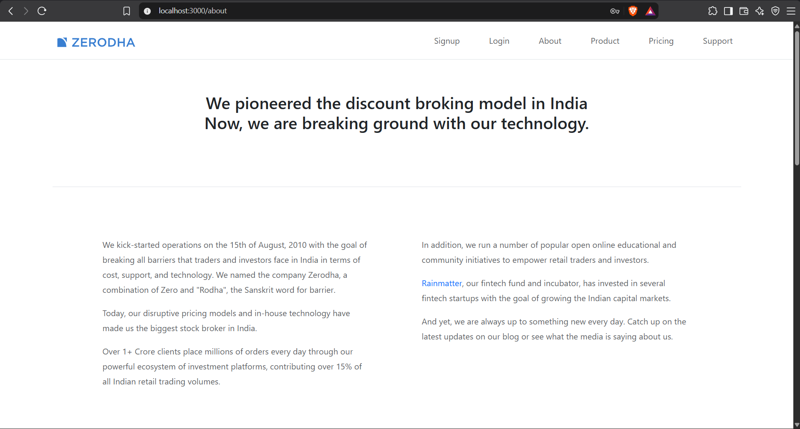
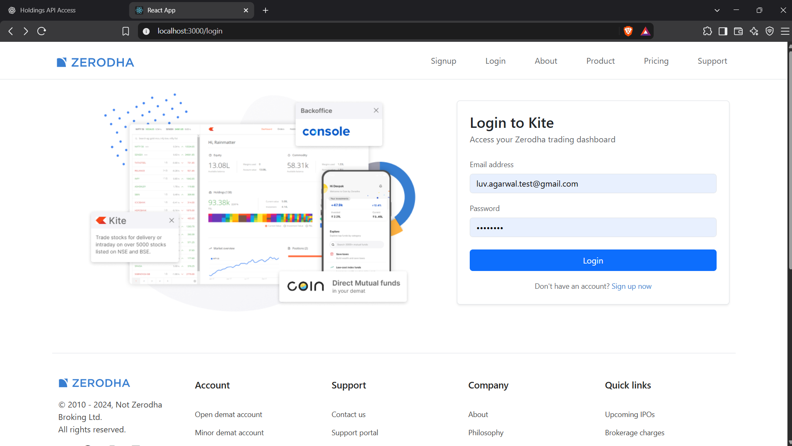
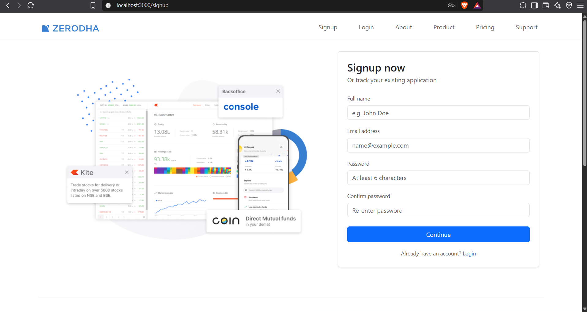
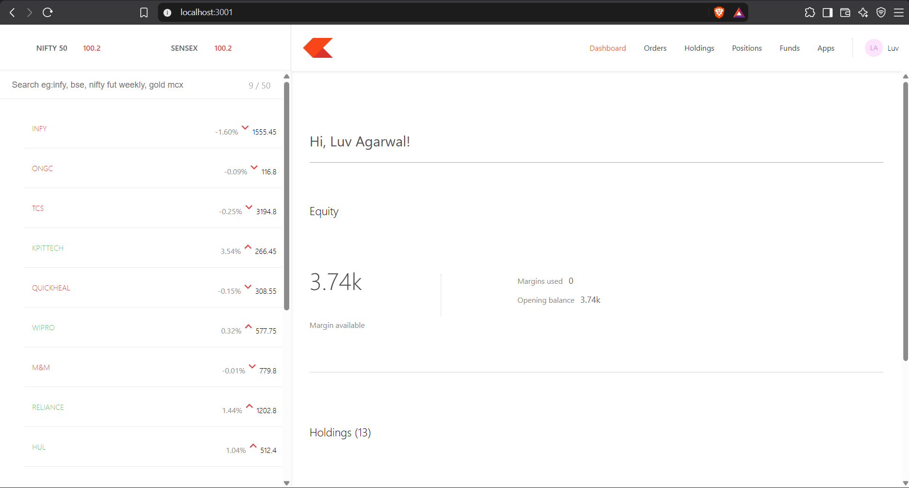
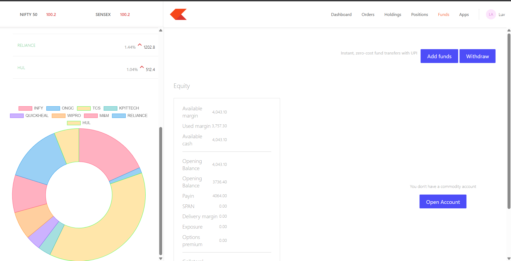
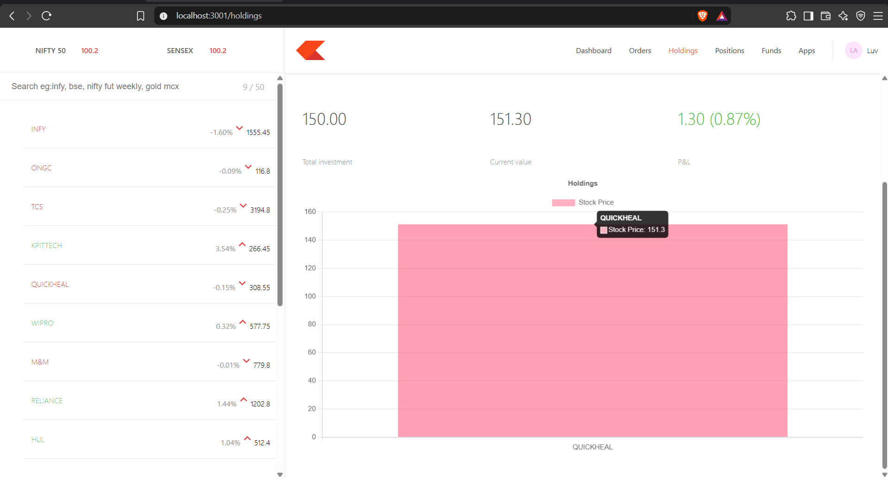
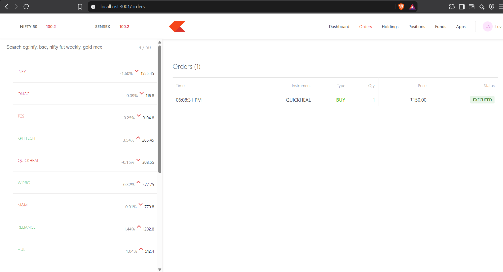
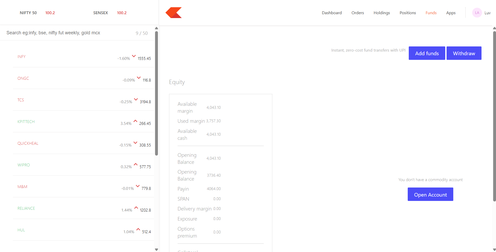

# Zerodha Clone

A full-stack stock trading platform inspired by Zerodha, built using the MERN stack. This project provides a trading dashboard where users can manage holdings, track positions, view orders, and explore stock market data.

## 🚀 Features

- User Authentication — Signup, login and logout.
- Trading Dashboard — Clean and interactive dashboard.
- Holdings Management — View stock holdings and portfolio details.
- Positions Tracking — Monitor current trading positions.
- Orders Management — Place and view orders.
- Stock Market Data — Integration with Alpha Vantage API.
- Secure Backend — JWT-based authentication and protected routes.
- Database Integration — MongoDB Atlas for persistent data storage.

## 🛠️ Tech Stack

**Frontend**
- React.js
- React Router
- Axios
- CSS / Bootstrap

**Dashboard**
- React.js
- React Router
- Axios

**Backend**
- Node.js
- Express.js
- MongoDB
- Mongoose
- JWT Authentication
- bcrypt.js

**Tools & Services**
- Git & GitHub
- MongoDB Atlas
- Alpha Vantage API
- Render
- Vercel

## 📁 Project Structure

```text
Zerodha-Clone/
│
├── frontend/       # Landing page and authentication
├── dashboard/      # Trading dashboard
├── backend/        # Express API and database logic
└── README.md
```

## 📸 Screenshots

### About


### Login & Signup



### Trading Dashboard


### Charts


### Holdings & Positions


### Orders


### Funds



## ⚙️ Installation & Setup

### 1. Clone the repository

```bash
git clone https://github.com/luv2501/Zerodha-Clone.git
cd Zerodha-Clone
```

### 2. Install dependencies

```bash
cd backend
npm install

cd ../frontend
npm install

cd ../dashboard
npm install
```

### 3. Configure Environment Variables

Create `.env` files in the respective folders and configure the required variables.

**Backend**
- MONGO_URL
- JWT_SECRET
- ALPHA_VANTAGE_API_KEY
- PORT
- NODE_ENV
- FRONTEND_URL
- DASHBOARD_URL

**Frontend**
- REACT_APP_BACKEND_URL
- REACT_APP_DASHBOARD_URL

**Dashboard**
- REACT_APP_BACKEND_URL
- REACT_APP_LANDING_PAGE_URL

Never commit actual secrets or API keys.

### 4. Run the application

Start the backend, frontend and dashboard in separate terminals using their respective start scripts.

```bash
npm start
```

## 🔐 Security

- Password hashing using bcrypt.js.
- JWT-based authentication.
- Protected API routes.
- Environment variables for sensitive configuration.

## 📌 Future Improvements

- Real-time stock price updates.
- Interactive portfolio analytics.
- Enhanced trading history.
- Improved mobile responsiveness.
- Advanced charts and market insights.

## 👨‍💻 Author

**Luv Agarwal**

GitHub: [@luv2501](https://github.com/luv2501)

---

⭐ If you find this project interesting, consider giving it a star!

